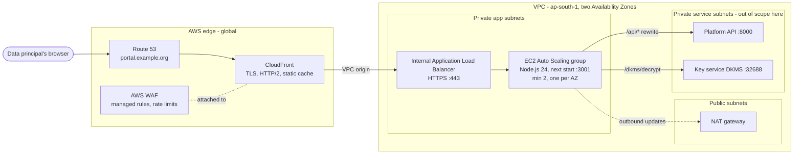

# Deploying the data-principal portal to AWS

**Scope:** the frontend layer of the data-principal portal, `frontend/portal`.
That is the Next.js application that data principals, the public and outside
ticket holders use (`/c/{token}`, sign-up, sign-in, rights, their records,
`/ticket/{token}`).

**Not in scope:** the API and its worker, the key service (DKMS), PostgreSQL and
Redis. The portal depends on them and this document lists what it needs from
them ([section 9](#9-what-the-portal-needs-from-the-rest-of-the-platform)).
The staff console follows the same pattern with one difference
([section 13](#13-the-staff-console)).

**No Docker.** The portal is deployed as a plain Node.js application: the build
output is copied to EC2 servers and run with `next start` under systemd. No
Docker image, no Dockerfile and no container service (ECS, EKS, Fargate) is
used anywhere in this design.

> **If the API stays inside the organisation's network** (no inbound
> connections), the portal reaches it through the public relay instead of a
> private network path: [backend/relay](../../backend/relay/README.md) and
> [ADR 0032](../decisions/0032-a-public-request-reaches-the-inside-only-when-the-inside-collects-it.md)
> (proof of concept, 2026-10-23). Three things below change in that shape:
> `API_ORIGIN` is the bridge on each instance (`http://127.0.0.1:8080`) and
> neither the API nor DKMS is reachable from AWS; the front door's timeouts
> must exceed the relay's upload deadline plus 5 s, and behind CloudFront the
> bridge needs `RELAY_CLIENT_IP_HOP=2`; and each portal instance needs a reply
> queue of its own, so the Auto Scaling group cannot simply scale out until a
> queue per instance is created at boot.

**Status:** proposal, 2026-10-14. Nothing here is provisioned yet. The facts
about how the portal builds and runs were checked against a production build
of the current code (`next build` and `next start`, Next.js 16.3.2) on
2026-10-14; they are marked *verified*.

---

## Contents

1. [What the portal is when it runs](#1-what-the-portal-is-when-it-runs)
2. [Rules the deployment must keep](#2-rules-the-deployment-must-keep)
3. [Recommended architecture](#3-recommended-architecture)
4. [AWS services and what each is for](#4-aws-services-and-what-each-is-for)
5. [Options considered and why not](#5-options-considered-and-why-not)
6. [Configuration: what is fixed at build, what is read at start](#6-configuration-what-is-fixed-at-build-what-is-read-at-start)
7. [End-to-end process](#7-end-to-end-process)
8. [Pipeline files (proposed)](#8-pipeline-files-proposed)
9. [What the portal needs from the rest of the platform](#9-what-the-portal-needs-from-the-rest-of-the-platform)
10. [Monitoring, logs and alarms](#10-monitoring-logs-and-alarms)
11. [Releasing, rolling back, patching](#11-releasing-rolling-back-patching)
12. [Must be resolved before go-live](#12-must-be-resolved-before-go-live)
13. [The staff console](#13-the-staff-console)
14. [Go-live checklist](#14-go-live-checklist)

---

## 1. What the portal is when it runs

The portal is **not a static website**. It cannot be uploaded to an S3 bucket
and served from there. It is a Node.js server (`next start`) that does four
things:

| What | Where in the code | Consequence for hosting |
|---|---|---|
| Renders every page on the server, per request | All 19 routes are dynamic (`ƒ`) in the build output - *verified* | A Node.js process must run. Only `/_next/static/*` (hashed JS/CSS) can be cached by a CDN |
| Adds a Content Security Policy with a fresh nonce to every page | `src/proxy.ts` | This is why no page can be pre-rendered or cached |
| Proxies `/api/*` to the platform API from its own origin | `rewrites()` in `next.config.ts` ([ADR 0003](../decisions/0003-server-side-sessions-and-first-party-proxy.md)) | The portal server must reach the API over the private network. The browser never calls the API directly |
| Exchanges ciphertext for plaintext at `/dkms/decrypt` | `src/app/dkms/decrypt/route.ts` | The portal server must reach the key service (DKMS) on the private network. The key service must never be reachable from the internet |

Other facts that shape the hosting:

- **Stateless.** Sessions live in Redis behind the API. The portal keeps nothing
  on disk and needs no sticky sessions, so any number of identical servers can
  run behind a load balancer.
- **No secrets.** The portal holds no password, key or token. Its settings are
  addresses and names.
- **Personal data passes through it.** Decrypted names and contacts leave
  `/dkms/decrypt` as plaintext. Pages under `/c/`, `/ticket/` and
  `/my-consents/` are sent `Cache-Control: no-store` (`next.config.ts`), and
  the decrypt response is `no-store, private`. No cache anywhere may store them.
- **Capability tokens are in URLs.** `/c/{token}`, `/ticket/{token}` and
  `/rights/nominations/{token}` are links that grant access by themselves. Any
  log that records full URLs records these tokens ([section 12](#12-must-be-resolved-before-go-live)).
- **Runtime footprint** (*verified*): the deployable bundle is about 16 MB of
  `.next` build output plus about 407 MB of production `node_modules`. The
  server starts in under a second. `next start` listens on all interfaces.

## 2. Rules the deployment must keep

These come from accepted decisions. A deployment that breaks one breaks the
application, or reverses a decision that must be taken again on purpose.

| Rule | Source | What it means on AWS |
|---|---|---|
| **No Docker: the portal runs as a plain process** | [ADR 0018](../decisions/0018-pip-and-a-virtualenv-no-containers.md) | The portal runs as `next start` directly on an EC2 server, managed by systemd. Nothing is packaged as a Docker image |
| **One origin per portal, `/api` proxied through it** | [ADR 0003](../decisions/0003-server-side-sessions-and-first-party-proxy.md) | The browser must reach the portal and its `/api` on the same hostname. `NEXT_PUBLIC_API_URL` stays unset. Splitting `/api` onto a different domain breaks sign-in with no error |
| **Two portals, two hostnames** | [ADR 0009](../decisions/0009-two-portals-by-audience.md) | The portal and the console are deployed separately, each on its own domain |
| **The key service is never public** | [DKMS docs](../dkms/README.md), `route.ts` | DKMS sits in a private subnet. Only the portal servers, the console servers and the API may reach it |
| **TLS is the deployment's job** | ADR 0018, *Consequences* | Nothing in the repository terminates TLS. CloudFront and the load balancer do |

## 3. Recommended architecture

**Amazon EC2 instances in an Auto Scaling group, running the portal with
`next start` under systemd, behind an Application Load Balancer, with
Amazon CloudFront and AWS WAF in front.** It runs the portal exactly as
development does (a Node.js process, no Docker), so it keeps ADR 0018. It also gives the
portal private network access to the API and the key service, which the
fully managed options do not ([section 5](#5-options-considered-and-why-not)).



How a request travels:

1. The browser resolves `portal.example.org` (Route 53) to CloudFront.
2. CloudFront terminates TLS and runs the WAF rules. `/_next/static/*` comes
   from the edge cache. Everything else goes to the origin uncached.
3. CloudFront reaches the **internal** load balancer through a CloudFront VPC
   origin, so the load balancer has no public address.
4. The load balancer sends the request to a healthy portal instance on port 3001.
5. The portal renders the page, or proxies `/api/*` to the API, or calls DKMS
   for `/dkms/decrypt`. All of this is inside the VPC.

> If your account cannot use CloudFront VPC origins, use an internet-facing
> load balancer instead. Allow inbound 443 only from the CloudFront managed
> prefix list (`com.amazonaws.global.cloudfront.origin-facing`), and have
> CloudFront add a secret header that a load-balancer listener rule requires.

## 4. AWS services and what each is for

| Service | Used for | Notes |
|---|---|---|
| **Route 53** | DNS for the portal's domain | Alias record to the CloudFront distribution |
| **AWS Certificate Manager (ACM)** | TLS certificates | Two certificates: one in **us-east-1** for CloudFront (CloudFront requires that region), one in the deployment region for the load balancer |
| **CloudFront** | Public entry point: TLS, HTTP/2 and HTTP/3, caching of `/_next/static/*`, HSTS header | Every other path uses the *CachingDisabled* policy |
| **AWS WAF** | Managed rule groups, per-IP rate limits, optional geo rules | Attached to CloudFront (web ACL in us-east-1, CloudFront scope). See the upload exception in [7.8](#78-cloudfront-and-waf) |
| **Amazon VPC** | Private network: subnets in two Availability Zones, route tables, security groups | Same VPC as the API and DKMS, or peered / Transit Gateway |
| **NAT gateway** *or* **VPC endpoints** | Outbound access from private instances for OS updates, SSM, CloudWatch, S3 | Endpoints for `ssm`, `ssmmessages`, `ec2messages`, `logs`, `monitoring`, `s3` (gateway) can replace most NAT traffic |
| **Elastic Load Balancing (ALB)** | Spreads requests across instances, health checks, draining during deploys | Internal, HTTPS listener, target group on port 3001 |
| **Amazon EC2 + Auto Scaling** | Runs the portal processes | Launch template + Auto Scaling group, minimum 2 instances across 2 AZs |
| **EC2 Image Builder** *(recommended)* | A hardened "golden" AMI (the EC2 server's disk image, not a Docker image) with Node.js, CodeDeploy agent and CloudWatch agent preinstalled | Rebuild monthly for OS patches |
| **AWS Systems Manager** | Session Manager (shell access with no SSH and no open port 22), Parameter Store (portal settings), Patch Manager | Parameters under `/compass/<env>/portal/` |
| **AWS CodePipeline** | Orchestrates source → build → deploy | Source from GitHub through an AWS CodeConnections connection |
| **AWS CodeBuild** | Installs, type-checks, lints, tests and builds the portal | One build per environment, because some settings are baked in at build ([section 6](#6-configuration-what-is-fixed-at-build-what-is-read-at-start)) |
| **AWS CodeDeploy** | Copies the build to every instance, restarts the service, checks health, rolls back | EC2/On-premises platform, deployment group = the Auto Scaling group |
| **Amazon S3** | Pipeline artifacts; CloudFront and ALB access logs | Block all public access, SSE-KMS, lifecycle expiry |
| **AWS KMS** | Encryption of EBS volumes, S3 buckets, CloudWatch log groups | Customer-managed key per environment |
| **Amazon CloudWatch** | Application logs (journald → CloudWatch agent), metrics, alarms, dashboards; Synthetics canary on `/sign-in` | Log retention set explicitly |
| **AWS IAM** | Instance role, CodeBuild role, CodeDeploy role, pipeline role | Least privilege ([7.5](#75-instance-role-and-launch-template)) |
| **Amazon SNS** | Alarm notifications to the on-call channel | |
| *Optional:* **AWS Shield Advanced** | DDoS response team and cost protection | Shield Standard is included with CloudFront at no charge |

**Region.** The data principals are in India and decrypted personal data passes
through the portal servers. Use **ap-south-1 (Mumbai)** or **ap-south-2
(Hyderabad)**, the same region as the API and DKMS. Confirm this with the DPO
against the organisation's data-localisation position before provisioning.

## 5. Options considered and why not

| Option | Why it is not the recommendation |
|---|---|
| **AWS Amplify Hosting** (managed Next.js) | Amplify's server compute cannot reach private resources in a VPC, and the portal must reach the API and DKMS privately. Making DKMS public to suit it is not acceptable. Also check Next.js 16 support before relying on it |
| **Lambda via OpenNext / SST** | Possible, but it re-packages Next.js into functions, splits the CSP proxy and the rewrites across Lambda and CloudFront, and adds a toolchain the team does not use. Cold starts would also hit a phone user on a consent link |
| **Elastic Beanstalk (Node.js platform)** | Also runs the portal as a plain Node.js process, and is a reasonable simpler alternative. It hides the same EC2 + ALB + Auto Scaling underneath with less control over the AMI, systemd and deployment hooks. Choose it if the team prefers fewer moving parts to configure |
| **S3 + CloudFront static site** | Not possible: every page is rendered on the server ([section 1](#1-what-the-portal-is-when-it-runs)) |

## 6. Configuration: what is fixed at build, what is read at start

Next.js inlines some values into the build output, so changing them needs a
**new build**, not a restart. This decides how the pipeline is shaped: **build
once per environment** (staging and production each get their own build).

| Variable | Fixed at | Required | Production value (example) | Notes |
|---|---|---|---|---|
| `NEXT_PUBLIC_STAFF_PORTAL_URL` | **build** | yes | `https://console.example.org` | `next build` refuses to run without it and warns on localhost or `http` (`src/lib/config/deployment.ts`) |
| `API_ORIGIN` | **build** | yes | `https://api.internal.example.org` or `http://<internal-api-alb>:80` | The `/api` rewrite target. **Verified 2026-10-14: the value is written into the build output; a different value at `next start` is ignored.** Unset, it defaults to `http://127.0.0.1:8000` |
| `NEXT_PUBLIC_APP_NAME` | build | no | `Consent Portal` | |
| `NEXT_PUBLIC_PRODUCT_NAME` | build | no | `COMPASS` | |
| `NEXT_PUBLIC_CSRF_HEADER`, `NEXT_PUBLIC_CSRF_COOKIE` | build | no | `X-CSRF-Token`, `cmp_csrf` | Must match the API's `CSRF_HEADER_NAME`, `CSRF_COOKIE_NAME` |
| `NEXT_PUBLIC_SESSION_COOKIE` | build | no | `cmp_session` | Must match the API's `COOKIE_NAME` |
| `NEXT_PUBLIC_TICKET_COOKIE` | build | no | `cmp_ticket` | Must match the API's `HOLDER_TICKET_COOKIE` |
| `NEXT_PUBLIC_DEV_SHOW_CODES` | build | — | **unset or `false`** | Development only. Never `true` in a deployed build |
| `NEXT_PUBLIC_QUERY_DEVTOOLS` | build | — | **unset** | Development only |
| `NEXT_PUBLIC_API_URL` | build | — | **unset** | Must stay unset ([ADR 0003](../decisions/0003-server-side-sessions-and-first-party-proxy.md)) |
| `DKMS_URL` | **start** | yes | `http://dkms.internal.example.org:32688` | Server only. **Verified: read when the server starts.** Unset, every decrypt answers 503 |
| `NODE_ENV` | start | yes | `production` | Turns off `unsafe-eval` in the CSP and adds `upgrade-insecure-requests` |
| `NEXT_TELEMETRY_DISABLED` | build and start | recommended | `1` | Stops Next.js sending usage telemetry |
| `HUSKY` | build | recommended | `0` | Skips the git-hook install that `npm ci` would otherwise attempt |

Store every value in **SSM Parameter Store** under
`/compass/<env>/portal/<NAME>` (String type: none of them is secret).
CodeBuild reads the build-time ones. The deploy script writes the start-time
ones into `/etc/compass/portal.env` on each instance.

## 7. End-to-end process

Do it once for **staging**, prove it, then repeat for **production**. Each
environment has its own VPC (or at least its own subnets and security groups),
parameters, pipeline and domain.

### 7.1 Decisions before starting

| Decision | Who | Recommended |
|---|---|---|
| AWS account(s) and region | Platform owner, DPO | Separate accounts for staging and production (AWS Organizations); ap-south-1 |
| Domain names | Platform owner | `portal.<org-domain>` and `console.<org-domain>`; staging `portal.staging.<org-domain>` |
| Where the API and DKMS run | Backend owner | Same VPC, private subnets. Their addresses become `API_ORIGIN` and `DKMS_URL` |
| CPU architecture | DevOps | **x86_64** to start. Graviton (arm64) is cheaper, but the build must then run on arm64 too, because `node_modules` contains native binaries |
| Access-log policy | DPO, Security | See [section 12](#12-must-be-resolved-before-go-live): the logs contain capability tokens |
| Client-IP fix | Backend owner | See [section 12](#12-must-be-resolved-before-go-live): must be fixed before go-live |

### 7.2 Network

1. Create (or reuse) the VPC with **two Availability Zones**:
   - public subnets: NAT gateway (one per AZ in production);
   - private **app** subnets: internal ALB and portal instances;
   - private **service** subnets: API, DKMS, databases (owned by the backend deployment).
2. Add VPC endpoints: `com.amazonaws.<region>.ssm`, `ssmmessages`,
   `ec2messages`, `logs`, `monitoring`, and the S3 gateway endpoint. They keep
   management traffic off the internet and reduce NAT cost.
3. If the API and DKMS are in another VPC, connect them with VPC peering or
   Transit Gateway and check that the route tables allow traffic both ways.

### 7.3 Security groups

| Group | Inbound | Outbound |
|---|---|---|
| `sg-portal-alb` | 443 from the CloudFront VPC-origin security group (or the CloudFront managed prefix list for a public ALB) | 3001 to `sg-portal-app` |
| `sg-portal-app` | **3001 from `sg-portal-alb` only.** No port 22: access is by Session Manager | API port (8000, or the API ALB's port) to the API's group; **32688 to `sg-dkms`**; 443 to VPC endpoints / NAT |
| `sg-dkms` *(backend-owned)* | **add:** 32688 from `sg-portal-app` | — |
| `sg-api` / API ALB *(backend-owned)* | **add:** the API port from `sg-portal-app` | — |

The key service must listen on an interface that other hosts can reach. A
DKMS bound to `127.0.0.1` cannot be reached from the portal (see
`frontend/portal/.env.example`).

### 7.4 Certificates and DNS

1. Request an ACM certificate for `portal.<domain>` in **us-east-1** (for
   CloudFront). Validate by DNS in Route 53.
2. Request a certificate for the ALB's internal name (for example
   `portal-origin.<domain>`) in the deployment region. CloudFront connects to
   the ALB over HTTPS with it.
3. Create the Route 53 alias record after the distribution exists ([7.8](#78-cloudfront-and-waf)).

### 7.5 Instance role and launch template

**AMI** - the EC2 server's operating-system disk image (build it with EC2 Image Builder, or prepare it once by hand for staging):

- Amazon Linux 2023, latest.
- **Node.js 24 LTS**, the same major version the team builds and tests with
  (development uses 24.18; `package.json` requires 22 or later). Install it from
  the Amazon Linux repository if that offers this major version, or else the
  official nodejs.org Linux binary, pinned and checksum-verified.
- CodeDeploy agent, CloudWatch agent, SSM agent (preinstalled on AL2023).
- A system user `compass` with no login shell, and the directories
  `/opt/compass/portal` (owned by `compass`) and `/etc/compass` (root, mode 0750).
- The systemd unit from [section 8](#83-systemd-unit), installed and enabled.

**Instance role** (attach as an instance profile):

- `AmazonSSMManagedInstanceCore` (Session Manager, Patch Manager);
- `CloudWatchAgentServerPolicy`;
- `ssm:GetParametersByPath` and `ssm:GetParameters` on
  `arn:aws:ssm:<region>:<account>:parameter/compass/<env>/portal/*`;
- `s3:GetObject` on the pipeline artifact bucket (CodeDeploy downloads the bundle);
- `kms:Decrypt` on the artifact bucket's key.

**Launch template:**

- instance type `t3.medium` (2 vCPU, 4 GiB) to start, then size from metrics;
- **IMDSv2 required** (`HttpTokens=required`, hop limit 1);
- encrypted gp3 root volume (20 GiB is plenty) with the KMS key;
- `sg-portal-app`, private app subnets, no public IP;
- user data: nothing application-specific. CodeDeploy installs the application.

### 7.6 Load balancer and target group

1. Target group `tg-portal`: protocol HTTP, port **3001**, target type instance.
   - Health check: `GET /sign-in`, success code `200`, interval 15 s,
     healthy threshold 2, unhealthy threshold 3, timeout 5 s.
     *Verified: `/sign-in` answers 200 from the portal alone, even when the API
     is unreachable.* An API outage therefore does not make the load balancer
     replace healthy portal servers.
   - Deregistration delay: 30 s (in-flight requests finish during a deploy).
   - Stickiness: off (the portal is stateless).
2. Internal ALB in the private app subnets with `sg-portal-alb`. HTTPS listener
   on 443 with the regional certificate, TLS policy
   `ELBSecurityPolicy-TLS13-1-2-2021-06`, forwarding to `tg-portal`.
3. Idle timeout: 60 s (default). Raise it only if large uploads time out.
4. Enable **drop invalid header fields**.

### 7.7 Auto Scaling group

- Launch template from [7.5](#75-instance-role-and-launch-template); subnets:
  both private app subnets.
- Minimum **2**, desired **2**, maximum **6** (production). Staging can run 1–2.
- Attached to `tg-portal`; health check type **ELB**, grace period 120 s.
- Target-tracking policy: average CPU 60 %. Add an ALB request-count-per-target
  policy once there is traffic to size it from.
- Instance refresh enabled, for rolling out a new AMI.

### 7.8 CloudFront and WAF

**Distribution:**

- Alternate domain name `portal.<domain>`, certificate from us-east-1,
  minimum protocol TLSv1.2_2021, HTTP/2 and HTTP/3 on, IPv6 on.
- **Origin:** VPC origin pointing at the internal ALB, HTTPS only, origin
  domain = the name on the ALB certificate. Origin response timeout 60 s.
- **Behaviours** (in this order):

| Path | Cache policy | Origin request policy | Methods | Why |
|---|---|---|---|---|
| `/_next/static/*` | `CachingOptimized` | none | GET, HEAD | Hashed, immutable files. The only thing safe to cache |
| `/api/*` | `CachingDisabled` | `AllViewer` | all | API calls carry the session cookie and personal data |
| `/dkms/*` | `CachingDisabled` | `AllViewer` | all | Plaintext personal data |
| default `*` | `CachingDisabled` | `AllViewer` | all | Every page is per-request (CSP nonce) and some carry personal data |

  `AllViewer` forwards every cookie (`cmp_session`, `cmp_csrf`, `cmp_ticket`),
  query string and header, which the session and CSRF scheme needs.
- **Response headers policy:** add `Strict-Transport-Security:
  max-age=31536000; includeSubDomains` (the application does not send HSTS
  itself). Leave the other security headers to the application, which already
  sends them, so they are not duplicated.
- Compression on. No geo restriction unless the DPO asks for one.
- Logging: see [section 12](#12-must-be-resolved-before-go-live) before turning it on.

**WAF web ACL** (scope CloudFront, region us-east-1), attached to the distribution:

| Rule | Action | Note |
|---|---|---|
| `AWSManagedRulesAmazonIpReputationList` | Block | |
| `AWSManagedRulesKnownBadInputsRuleSet` | Block | |
| `AWSManagedRulesCommonRuleSet` | Block, **with `SizeRestrictions_BODY` set to Count** | The portal uploads rights-request documents of up to 25 MB through `/api`. That rule blocks any body over 8 KB and would break every upload |
| Rate-based rule on `/api/auth/*` | Block above, for example, 300 requests per 5 minutes per IP | Coarse protection in front of the API's own rate limits |
| Rate-based rule on everything | Block above, for example, 2,000 per 5 minutes per IP | Tune from real traffic |

Then create the Route 53 alias `portal.<domain>` → the distribution.

### 7.9 Parameters

Create the parameters from [section 6](#6-configuration-what-is-fixed-at-build-what-is-read-at-start):

```bash
ENV=staging
P=/compass/$ENV/portal
aws ssm put-parameter --name $P/NEXT_PUBLIC_STAFF_PORTAL_URL --type String --value https://console.staging.example.org
aws ssm put-parameter --name $P/API_ORIGIN                   --type String --value https://api.internal.staging.example.org
aws ssm put-parameter --name $P/NEXT_PUBLIC_APP_NAME         --type String --value "Consent Portal"
aws ssm put-parameter --name $P/DKMS_URL                     --type String --value http://dkms.internal.staging.example.org:32688
```

### 7.10 Pipeline

1. **Artifact bucket:** S3, block public access, SSE-KMS, versioning, lifecycle
   expiry of old artifacts after 30–90 days.
2. **Connection:** an AWS CodeConnections connection to the GitHub repository
   (`pranaldongare/COMPASS_CMP`), approved by a repository admin.
3. **CodeBuild project** `compass-portal-<env>-build`:
   Amazon Linux build environment of the chosen architecture, `buildspec` path
   `frontend/portal/deploy/buildspec.yml` ([8.1](#81-buildspecyml)). Its role
   may read `/compass/<env>/portal/*` and write to the artifact bucket.
4. **CodeDeploy application** `compass-portal`, deployment group
   `<env>`: platform EC2/On-premises, target = the Auto Scaling group, load
   balancer = `tg-portal` (so instances are taken out of the target group
   while they are updated), configuration `CodeDeployDefault.OneAtATime` (or
   `HalfAtATime` in production with 4+ instances), **automatic rollback on
   deployment failure and on alarm** (the alarms from [section 10](#10-monitoring-logs-and-alarms)).
5. **CodePipeline** `compass-portal-<env>`:
   - Source: the connection, branch `main` for production (or the branch the team
     releases from), the integration branch for staging. Trigger with a path
     filter on `frontend/portal/**`.
   - Build: the CodeBuild project.
   - *Production only:* a **manual approval** stage.
   - Deploy: the CodeDeploy deployment group.

The pipeline files do not exist in the repository yet. [Section 8](#8-pipeline-files-proposed)
has a proposed version of each, to be added under `frontend/portal/deploy/` in
the change that sets the pipeline up.

### 7.11 First deployment and smoke test

Release once through the pipeline, then check, from outside and from an instance:

| Check | Expected |
|---|---|
| `curl -sI https://portal.<domain>/sign-in` | `200`, `content-security-policy` with a nonce, `strict-transport-security`, `x-frame-options: DENY`, `cache-control: …no-store…` |
| Load `/sign-in` twice and compare the CSP header | The nonce differs each time (nothing is cached) |
| `curl -s https://portal.<domain>/api/ready` | The API's readiness JSON. Proves the `/api` rewrite reaches the API |
| On an instance (Session Manager): `curl -s $DKMS_URL/health` | Answers. Proves the network path to the key service |
| Sign in by code as a test data principal | Sign-in completes; the session cookie is `Secure`, `HttpOnly`, on the portal's domain |
| Open a consent link `/c/{token}` from staging data | Names and contacts show as text, not `SE::…` (decryption works) |
| Upload a document of a few MB on a rights request | Accepted (WAF body-size rule correctly in Count) |
| Sign in as staff on the portal | Pointed to `NEXT_PUBLIC_STAFF_PORTAL_URL` |
| Stop the service on one instance | The ALB marks it unhealthy within about 45 s; the site stays up |

## 8. Pipeline files (proposed)

Drafts to adapt, not yet in the repository. They assume the portal is deployed
to `/opt/compass/portal/current`, runs as `compass`, and listens on 3001.

### 8.1 `buildspec.yml`

```yaml
# frontend/portal/deploy/buildspec.yml
version: 0.2

env:
  variables:
    NEXT_TELEMETRY_DISABLED: "1"
    HUSKY: "0"
    # DEPLOY_ENV (staging | production) is set on each CodeBuild project.
    # Do not set NODE_ENV here: npm ci would skip the dev dependencies the
    # tests and the build need, and `next build` sets it to production itself.

phases:
  install:
    runtime-versions:
      nodejs: 24                  # if the build environment lacks 24, install the pinned version here instead
  pre_build:
    commands:
      - cd frontend/portal
      # Build-time values: inlined into the bundle by `next build`.
      - |
        for name in NEXT_PUBLIC_STAFF_PORTAL_URL API_ORIGIN NEXT_PUBLIC_APP_NAME; do
          value=$(aws ssm get-parameter --name "/compass/$DEPLOY_ENV/portal/$name" \
                    --query Parameter.Value --output text)
          echo "export $name='$value'" >> /tmp/portal-build.env
        done
      - npm ci
      - npm run verify                       # typecheck + lint + unit tests
  build:
    commands:
      - . /tmp/portal-build.env && npm run build
      - npm prune --omit=dev                 # verified: next start needs production deps only
      - rm -rf .next/cache                   # 64 MB of build cache, not needed to run
      - cp deploy/appspec.yml .

artifacts:
  base-directory: frontend/portal
  files:
    - appspec.yml
    - deploy/**/*
    - .next/**/*
    - node_modules/**/*
    - public/**/*
    - package.json
    - package-lock.json
    - next.config.ts
    - tsconfig.json
    - src/lib/config/**/*                    # next.config.ts imports it at start
```

The CodeBuild role needs `ssm:GetParameter` on `/compass/<env>/portal/*`.
Each `phases` command runs in the same shell in CodeBuild's default (version
0.2) mode, so `cd frontend/portal` carries over. If you use a CodeBuild
setting that runs commands in separate shells, repeat the `cd`.

*Verified 2026-10-14:* a bundle of exactly these files (production
`node_modules`, `.next` without `cache`, `public`, `package.json`,
`next.config.ts`, `tsconfig.json`, `src/lib/config`) starts with
`node node_modules/next/dist/bin/next start --port 3001` and serves pages.

### 8.2 `appspec.yml` and hook scripts

```yaml
# frontend/portal/deploy/appspec.yml
version: 0.0
os: linux
files:
  - source: /
    destination: /opt/compass/portal/releases/incoming
file_exists_behavior: OVERWRITE
permissions:
  - object: /opt/compass/portal/releases/incoming
    owner: compass
    group: compass
hooks:
  ApplicationStop:
    - location: deploy/stop.sh
      timeout: 60
      runas: root
  AfterInstall:
    - location: deploy/install.sh
      timeout: 120
      runas: root
  ApplicationStart:
    - location: deploy/start.sh
      timeout: 60
      runas: root
  ValidateService:
    - location: deploy/validate.sh
      timeout: 120
      runas: root
```

```bash
# deploy/stop.sh - stop the running portal (absent on a first install)
#!/usr/bin/env bash
set -euo pipefail
systemctl stop compass-portal || true
```

```bash
# deploy/install.sh - make the new release current, write the runtime settings
#!/usr/bin/env bash
set -euo pipefail
ENV_NAME="$(cat /etc/compass/environment)"          # "staging" or "production", baked into the AMI or set by user data
ROOT=/opt/compass/portal
RELEASE="$ROOT/releases/$(date -u +%Y%m%d%H%M%S)"
mv "$ROOT/releases/incoming" "$RELEASE"
ln -sfn "$RELEASE" "$ROOT/current"

# Runtime (start-time) settings only. Build-time ones are already in the build.
TOKEN=$(curl -s -X PUT http://169.254.169.254/latest/api/token -H "X-aws-ec2-metadata-token-ttl-seconds: 60")
REGION=$(curl -s -H "X-aws-ec2-metadata-token: $TOKEN" http://169.254.169.254/latest/meta-data/placement/region)
DKMS_URL=$(aws ssm get-parameter --region "$REGION" --name "/compass/$ENV_NAME/portal/DKMS_URL" --query Parameter.Value --output text)
umask 027
cat > /etc/compass/portal.env <<EOF
NODE_ENV=production
NEXT_TELEMETRY_DISABLED=1
DKMS_URL=$DKMS_URL
EOF
chgrp compass /etc/compass/portal.env

# Keep the last five releases for a fast manual rollback.
ls -1dt "$ROOT"/releases/*/ | tail -n +6 | xargs -r rm -rf
```

```bash
# deploy/start.sh
#!/usr/bin/env bash
set -euo pipefail
systemctl daemon-reload
systemctl start compass-portal
```

```bash
# deploy/validate.sh - the instance only rejoins the load balancer if this passes
#!/usr/bin/env bash
set -euo pipefail
for i in $(seq 1 30); do
  code=$(curl -s -o /dev/null -w '%{http_code}' http://127.0.0.1:3001/sign-in || true)
  [ "$code" = "200" ] && exit 0
  sleep 2
done
echo "portal did not answer 200 on /sign-in" >&2
journalctl -u compass-portal -n 50 --no-pager >&2
exit 1
```

### 8.3 systemd unit

```ini
# /etc/systemd/system/compass-portal.service (baked into the AMI)
[Unit]
Description=COMPASS data-principal portal (Next.js)
After=network-online.target
Wants=network-online.target

[Service]
User=compass
Group=compass
WorkingDirectory=/opt/compass/portal/current
EnvironmentFile=/etc/compass/portal.env
ExecStart=/usr/bin/node node_modules/next/dist/bin/next start --port 3001
Restart=always
RestartSec=3
# Let in-flight requests finish when CodeDeploy stops the service.
KillSignal=SIGTERM
TimeoutStopSec=30
# Hardening
NoNewPrivileges=true
ProtectSystem=strict
ProtectHome=true
PrivateTmp=true
ReadWritePaths=/opt/compass/portal
LimitNOFILE=65536

[Install]
WantedBy=multi-user.target
```

Use the path `node` is installed at (`which node`). The unit starts Next
through `node_modules/next/dist/bin/next` rather than `node_modules/.bin/next`,
because the `.bin` symlinks may not survive the zip that CodeBuild produces.

## 9. What the portal needs from the rest of the platform

The backend deployment owns these, but the portal does not work without them.

| Item | Setting / action | Why |
|---|---|---|
| API reachable from the portal servers | Security group rule; the address is `API_ORIGIN` | The `/api` rewrite |
| API base URL for links | `PUBLIC_BASE_URL=https://portal.<domain>` on the API | Consent links, acceptance links and ticket links in emails and SMS point at the portal |
| Console URL | `CONSOLE_BASE_URL=https://console.<domain>` on the API | Staff links |
| Cookies | `COOKIE_SECURE=true` (the API refuses to start in production without it); `COOKIE_NAME`, `CSRF_*`, `HOLDER_TICKET_COOKIE` matching the portal's build | The session is set by the API through the portal's origin |
| CORS | `CORS_ORIGINS` **empty** | The browser never calls the API cross-origin |
| Key service reachable from the portal servers | `sg-dkms` rule; the address is `DKMS_URL` | `/dkms/decrypt` |
| **Same key** | The DKMS the portal calls must hold the master key the API sealed the data with | Otherwise every name shows as `SE::…` |
| Client IP | See [section 12](#12-must-be-resolved-before-go-live) | Audit trail and rate limits |

## 10. Monitoring, logs and alarms

**Application logs.** `next start` writes to stdout, which systemd keeps in
journald. Configure the CloudWatch agent to ship the `compass-portal` unit's
journal to the log group `/compass/<env>/portal` (KMS-encrypted, retention
90 days or as the DPO sets). The portal logs no request bodies, and the decrypt
route logs only the key service's host and the failure, never a value.

**Alarms** (to SNS → on-call; the first three also trigger CodeDeploy rollback):

| Alarm | Condition |
|---|---|
| Healthy hosts low | `HealthyHostCount` on `tg-portal` < 2 for 2 minutes (production) |
| Target 5xx | `HTTPCode_Target_5XX_Count` above a baseline for 5 minutes |
| CloudFront 5xx rate | `5xxErrorRate` > 1 % for 5 minutes |
| Synthetic check failed | A CloudWatch Synthetics canary loading `https://portal.<domain>/sign-in` every 5 minutes fails twice in a row |
| CPU / memory | Average CPU > 80 % for 10 minutes; memory (CloudWatch agent) > 85 % |
| WAF blocks spike | `BlockedRequests` well above normal: an attack, or a rule blocking real users |
| Decrypt failures | A metric filter on `[dkms]` lines in the portal log; any occurrence is worth a look |

**Dashboard:** request count, latency (p50/p95) and 4xx/5xx from the ALB and
CloudFront, healthy hosts, CPU and memory per instance, WAF allowed/blocked.

## 11. Releasing, rolling back, patching

- **Release:** merge to the release branch → the pipeline builds, tests, waits for
  approval (production) and deploys one instance at a time. Each instance
  leaves the load balancer, is updated, passes `validate.sh`, and rejoins.
- **Automatic rollback:** a failed hook or a firing alarm makes CodeDeploy
  redeploy the last good revision.
- **Manual rollback:** in CodeDeploy, redeploy the previous successful revision.
  In an emergency, on each instance, point `current` at the previous directory
  under `releases/` and `systemctl restart compass-portal`.
- **Configuration change:**
  - a build-time value (`NEXT_PUBLIC_*`, `API_ORIGIN`): change the parameter,
    then **re-run the pipeline**. A restart does nothing;
  - `DKMS_URL`: change the parameter, then redeploy (the `install.sh` hook
    rewrites `/etc/compass/portal.env`), or update the file and restart the
    service on each instance.
- **OS patching:** rebuild the AMI monthly with Image Builder and run an
  Auto Scaling **instance refresh**. In between, use Patch Manager for urgent
  fixes.
- **Node.js or Next.js upgrade:** change it in development and CI first. Update
  the AMI's Node version in the same change that requires it.

## 12. Must be resolved before go-live

These were found while preparing this document. Each one is a decision or a
change outside this document. None of them is done yet.

1. **The client IP the API records can be faked.** In production the API takes
   the *first* address in `X-Forwarded-For` as the client
   (`backend/api/src/cmp/api/middleware/request_context.py`, `client_ip`).
   *Verified 2026-10-14:* the portal's `/api` rewrite passes a client-supplied
   `X-Forwarded-For` through **unchanged** and adds nothing of its own.
   CloudFront and the ALB **append** to that header rather than replacing it,
   so behind them a visitor who sends `X-Forwarded-For: 1.2.3.4` is recorded
   as `1.2.3.4`. This affects the audit trail's `ip_address` and every per-IP
   rate limit, including the failed-sign-in budget. **Fix (backend):** take
   the address a fixed number of trusted hops from the *right* of the header
   (with CloudFront → ALB → portal, the viewer is the second from the right;
   confirm in staging with a header echo), or take CloudFront's
   `CloudFront-Viewer-Address` header, which a client cannot set. Owner: the
   backend lead. This also concerns the console, which proxies the same way.
2. **Access logs contain capability tokens.** CloudFront and ALB access logs
   record the request path, which for `/c/{token}`, `/ticket/{token}` and
   `/rights/nominations/{token}` *is* the access token. Decide with the DPO
   and Security whether to (a) leave those logs off, or (b) keep them in a
   KMS-encrypted bucket that only Security can read, with a short expiry
   (for example 30 days). Do not send them to a shared logging account
   without this decision.
3. **No HSTS from the application.** Add it at CloudFront ([7.8](#78-cloudfront-and-waf)).
   Listed so it is not forgotten.
4. **Region and data residency.** Confirm the region with the DPO
   ([section 4](#4-aws-services-and-what-each-is-for)).
5. **CI is red** ([ADR 0018](../decisions/0018-pip-and-a-virtualenv-no-containers.md), *Consequences*).
   The CodeBuild stage above runs `npm run verify` itself, so the portal's
   release does not depend on GitHub Actions. Fixing CI remains its own task.

## 13. The staff console

`frontend/console` deploys the same way, with these differences:

- its own pipeline, Auto Scaling group, target group (port **3000**), domain
  (`console.<domain>`) and parameters (`/compass/<env>/console/`);
- its build-time cross-portal address is `NEXT_PUBLIC_SUBJECT_PORTAL_URL`
  (= `https://portal.<domain>`) instead of `NEXT_PUBLIC_STAFF_PORTAL_URL`;
- **it should not be open to the whole internet.** Restrict it to staff:
  a WAF IP allow-list of the office and VPN ranges, or AWS Verified Access, or
  reach it only over the corporate network/VPN through an internal ALB. Staff
  sign-in already requires MFA ([ADR 0006](../decisions/0006-mfa-for-every-staff-role.md));
  network restriction is in addition to it.

## 14. Go-live checklist

- [ ] Region confirmed with the DPO; accounts and VPC ready in two AZs
- [ ] Security groups as in [7.3](#73-security-groups); DKMS and API allow the portal; no port 22 anywhere
- [ ] Certificates issued (us-east-1 for CloudFront, regional for the ALB)
- [ ] Parameters created for the environment; `NEXT_PUBLIC_DEV_SHOW_CODES` and `NEXT_PUBLIC_API_URL` unset
- [ ] AMI built with Node.js 24, CodeDeploy and CloudWatch agents, the `compass` user and the systemd unit
- [ ] Launch template with IMDSv2 required and an encrypted volume; ASG minimum 2 across 2 AZs
- [ ] Internal ALB, target group health check `/sign-in` → 200
- [ ] CloudFront behaviours: only `/_next/static/*` cached; HSTS added; VPC origin over HTTPS
- [ ] WAF attached, `SizeRestrictions_BODY` in Count, rate rules set
- [ ] Pipeline: build → (approval) → deploy, with automatic rollback on failure and alarms
- [ ] API settings: `PUBLIC_BASE_URL`, `CONSOLE_BASE_URL`, `COOKIE_SECURE=true`, `CORS_ORIGINS` empty
- [ ] **Client-IP fix deployed in the API** ([12.1](#12-must-be-resolved-before-go-live))
- [ ] **Access-log decision taken** ([12.2](#12-must-be-resolved-before-go-live))
- [ ] Smoke tests in [7.11](#711-first-deployment-and-smoke-test) all pass on staging, then on production
- [ ] Alarms firing to the on-call channel; dashboard in place; runbook link added
