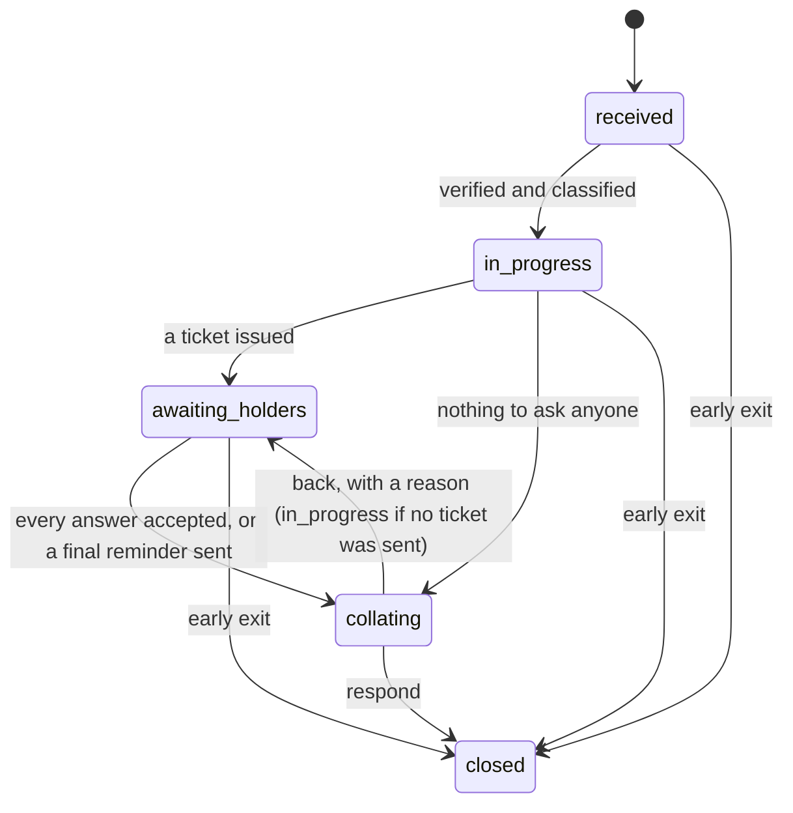

# Rights requests

How a data principal exercises the rights the Act gives her (ss.11 to 14),
and how the Privacy Office answers within a published period with a record it
can produce. The backend's own reference, including the clock arithmetic and
the enforcement inventory, is
[rights.md](../architecture/rights-module.md); this page is the
workflow as people experience it.

## The three requests

Why, and what was given up: [ADR 0026](../decisions/0026-a-rights-request-is-access-erasure-or-a-grievance-about-everything.md).

| Type | Section | What she asks | What she gets back |
|---|---|---|---|
| `access` | s.11 | a summary of her data, the processing, and who it was shared with | the summary, and any files the office releases with it |
| `erasure` | s.12 | erasure of her data | a decision per appearance of her in an asset: erased, redacted, retained or quarantined |
| `grievance` | s.13 | a complaint, usually about how another request was handled | a finding: upheld or not, with the route to the Board |

**Three, not four (DPO, 2026-10-07).** A new request is access, erasure or a
grievance, on every channel - the portal, the public form, a nominee, and one
the DPO logs - and nothing is reclassified as a correction. A correction to
her name is made from her account (S3-05). The `correction` type stays in the
database for requests made before, which are handled to the end as they were:
the classification card offers a request its own type, and a correction
counts as carried out as before. The server refuses the fourth
(`cmp.domain.rights.service.taken`), so a stale client cannot bring it back.

Every request has a reference like `RR-2026-000042`, minted by the database,
which is what she quotes on the phone, in the public form, and in a grievance.

## Where a request comes from

| Channel | Who | How identity is established |
|---|---|---|
| `portal` | a signed-in data principal | her session |
| `public_form` | anyone, from the rights page | a code sent to a contact on file - an account's, or since 0065 the address a dismissed report from the public link came from - or the DPO's manual verification |
| `nominee` | a nominee whose nomination is in effect | the nominee's own sign-in, plus the event evidenced |
| `staff_logged` | the DPO, from an email or a letter | the DPO's verification note |

The public form is deliberately neutral: it issues a reference whether or not
the contact is known, and the code goes only to a contact on file - an account's
email, else its mobile, whichever was typed. The reply says so, the same for
everybody (2026-11-08): "Thank you. Your request has been recorded. If we hold
records for the contact you gave, a verification code has been sent to the contact
we hold for you." A contact with no account that is the address of a report an
office dismissed, not yet erased, is one: the code goes to the address stored on
the report, never to the one typed, so the neutral reply stays true for a reporter
with no account, and a code the office sends
(`POST /requests/{uuid}/verification/code`) goes there too.
The request's detail tells the DPO and the Legal PoC whether a code has somewhere to
go (`code_channel`, 2026-11-08): `true` with an account, or with none when the
contact is such a report's address; `false` when no channel is held, so the request
is verified by hand or closed as not verified; `null` for the administrator, for a
request no longer waiting for its identity or past `awaiting_holders`, and when the
key service does not answer. It never carries the address. On a request with no
account, **Send a code** and **Confirm** are the DPO's and the Legal PoC's alone:
anybody else - in practice the administrator on a request about the office - gets
403 `officers_only`, "Only the DPO or the Legal office can send or confirm a code
for a request with no account.", after the checks on the request's state and
before anything is opened or a code is checked, so the answer is the same whether
or not the contact sent a dismissed report (2026-11-08). Before, Send a code
answered them 200 for a dismissed reporter and 422 for a stranger, and Confirm's
fifth wrong code answered 429 and spent the reporter's code. A request with an
account is unchanged. On the form's second half (`POST /rights/requests/verify`) a
wrong code, a code of four to ten digits other than six and a spent budget of five
tries all answer 400 `otp_invalid`, "Invalid or expired code", as a reference no
code was sent for does: the fifth wrong try discards the code, and only the limit
per address (30 an hour) answers 429. A malformed body - a code of fewer than four
or more than ten digits or with anything but digits, or a reference shorter than
six or longer than 24 characters - is refused before anything is looked up, with
422 `validation_failed`, the same for every caller. Neither that code nor one an
officer confirms stamps anything on the account: it proves that whoever made the
request holds the address it went to, not that the account's holder does
([what a code proves](../security/authentication.md#what-a-code-proves)). An
unverified request is closed by the nightly sweep after seven days, and a
stranger who asks after it is told only that it is closed.

**A request is about everything held on her** (DPO, 2026-10-07): every
project and every consent, never one. There is no project or consent to pick
on any form, and the API refuses a `consent_uuid` on a new request. A request
made before that and confined to one consent still shows the consent it was
confined to, and its holders stay derived from that consent's chain.

**Documents with a request** (2026-10-07). Signed in, she can send documents
with her request - a proof of who she is, a letter, a screenshot: PDF, PNG,
JPEG, text or Word, 25 MB each, at most ten, while the request is open. The
portal sends them once the request is recorded, so the clock runs from the
request; one refused does not undo it. Each is kept as it came
(`rights_request_attachment`, append-only, the name sealed) and the DPO
downloads it from the request page; every download is on the trail, which
never records a name. The public form takes none: nobody is known until the
code is confirmed.

## Which office answers

A request belongs to the office whose notices the person holds a consent on
(0055, [the HR track](hr-track.md#5-rights-requests-and-breaches-by-office)):
the **DPO office** for the research projects' notices, the **Legal office**
for her employer's HR activities. The service decides on receipt
(`domain/rights/service.office_for`), from what is known then:

| What is known | Office |
|---|---|
| a consent on the Legal office's notices only | `hr` - the Legal PoC's queue |
| a consent on the DPO office's notices only | `rnd` - the DPO's queue |
| consents with both | the portal asks her which, or **both**: one request to each, the same received date, each with its own reference |
| nothing - the public form before its code, a stranger, a signed-in person with no consent | the **shared intake**: no office, in both queues until one claims it |
| the request is confined to one consent | that consent's office |
| a dispute of an earlier request, or its re-run | the earlier request's office |
| logged by an officer (`staff_logged`) | the logging officer's office |

A withdrawn consent still counts: the office holds what was collected before
it. The portal reads her offices from `GET /me/requests/offices`.

**Claim.** An officer takes a request out of the shared intake into their
office's queue (`POST /requests/{uuid}/claim`); verifying who it is can come
first, but work cannot start until it is claimed (*Claim it for your office
first*). A claim is made once: the second office is told it is not there.
Audited `rights.claimed`.

**Transfer.** An office sends a request it holds to the other office with a
reason (`POST /requests/{uuid}/transfer` `{office, reason}`): the office
changes, the request records where it came from, when, by whom and why (the
reason sealed), the move is audited `rights.transferred` (never the reason),
and the receiving office's officers are emailed
(`rights_transfer_received`). The received date, the due date and the
checkpoints do not move; holders derived so far stay. The request leaves the
sender's queue with the statement that moves it, and it can be sent back the
same way. A request in the shared intake is claimed, not transferred.

The database holds the rule: `rights_request.office_id` changes only by a
claim (from none, with who and when) or a transfer (with a new stamp, who,
why and where from) - `cmp_rights_request_office_moves()`, tested in
`tests/integration/enforcement/test_rights_office_moves.py`.

**Who is told.** A request's arrival, the daily list of what is due and a
holder's message go to the officers of its office - the DPO for `rnd`, the
Legal PoC for `hr` - and, while it is in the shared intake, to both.

## The clock

The clock starts at receipt (D0), not at verification, and the due date is
stamped on the row at receipt so a later change in configuration never moves
a running request. The default period is the Rule 14 outer limit.

| Checkpoint | Default | Setting |
|---|---|---|
| Acknowledge | D0 + 2 days | `RIGHTS_ACKNOWLEDGE_WITHIN_DAYS` |
| Tickets issued | D0 + 5 days | `RIGHTS_TICKETS_WITHIN_DAYS` |
| Halfway | midway | derived |
| Collate | D - 5 days | `RIGHTS_COLLATE_BEFORE_DAYS` |
| Respond | D0 + 90 days | `RIGHTS_RESPONSE_PERIOD_DAYS`, `GRIEVANCE_RESPONSE_PERIOD_DAYS` |

The API returns the checkpoints on every request, so the console, the
acknowledgement email and the dashboard cannot disagree about a date.

## The states

An **early exit** - not verified, refused, reclassified as a withdrawal, or
the event not evidenced - closes the request from any state before
collating (`OPEN_BEFORE_COLLATION`). Once the DPO is collating, the response
is finished instead.

Closure carries an **outcome**: `complete`, `partial`, `no_records`,
`refused`, `not_verified`, `reclassified_withdrawal`, or for a grievance
`upheld` or `not_upheld`. A response that does not give her what she asked
names the Data Protection Board as the next step.

Moving `received` to `in_progress` needs the request verified and classified;
for an erasure the intent confirmed with her; for a nominee's request the
event evidenced; for a grievance about the DPO, an independent reviewer
assigned. The transitions endpoint says what is missing, and the console
shows it beside a disabled button.

## Holders and tickets

A **holder** is a party that holds her data, found from the disclosure
records and the assets (`export_line`, `asset_consent`) - and, on the Legal
office's requests, from the processors of the HR category of every activity
she consented on (`activity_processor`, answered by the category's named
respondent or the activity's HR PoC) - and confirmed by the
DPO, who may add one by hand, and remove one found by mistake while nothing
has been sent to it. Each confirmed holder gets one **ticket**: the
instruction to return what it holds, addressed to a **respondent** of that
processor.

**Every holder needs an email address** (2026-10-08): whoever answers is
emailed the ticket. A holder is not added or confirmed without one, or a
registered respondent who signs in; sending tickets refuses any holder still
without one (`holder_without_address`), and the card marks it. Until the
ticket goes, *Change who answers* changes the person or the address; after,
*Correct their email* (`POST .../correct-contact`) sends the ticket again to
the right address, writes to nobody at the wrong one, gives an outside holder
a new link, and records `rights.holder_contact_corrected`.

**A request goes back from collating** when the office moved it too soon - a
holder still to ask, more needed from one. *Back to awaiting holders* (or to
in progress, if no ticket was ever sent) takes a reason, one of
`new_holder`, `more_from_holder` or `other`, kept on the trail as `why`. The
clock does not pause.

Each holder's ticket asks in its own words: it starts from the standard words
for the kind of request (and the consent it is confined to), and the DPO may
change them for that holder until the ticket is sent (`PUT
.../holders/{holder_uuid}/instruction`). An erasure ticket also lists the
items that holder holds and what to do with each - erase it, remove the person
from it, keep it until a date, or set it aside - including items found before
the holder was, which become its own when it is asked.

### How a holder is reached

Decided with the product owner on 2026-10-08 and settled as the ticket is
sent (`domain/rights/reach.py`), so the office may name and rename a responder
freely until then. "Internal" is an address on `BREACH_TICKET_EMAIL_DOMAINS`. The decision: [ADR 0024](../decisions/0024-a-rights-tickets-holder-is-reached-three-ways.md).

| The responder | Reached | Answers |
|---|---|---|
| an account that signs in to the console | the ticket in their **My tasks**; the email in full, with a link to it | in the console, with files |
| an internal address with no console login | a **temporary login**, as a breach ticket's holder has (0049; [roles-and-access.md](roles-and-access.md)), then as above | in the console |
| any other address - a vendor, a third-party processor | an email carrying **a link and nothing of the request** | on the **portal**, at `/ticket/{token}`, after a one-time code sent to the address on the ticket |

An outside holder's link (`domain/rights/holder_link.py`) shows only the
reference, the holder's name and where the code will go. The code goes to the
address the ticket was sent to, never one typed, and opens the ticket for an
hour in that browser: an HttpOnly, SameSite=Strict cookie whose fingerprint in
Redis names the ticket and the link, and every call names the link too. The
holder then reads what is asked, the items, and the platform's brief of what it
already holds about the person; writes to the office with files; and gives
its answer, which waits for review like any other. Every email to it - the
ticket, a message, a reminder, a ticket sent back, withdrawn, reopened or moved
- says what happened and gives the link, nothing more. Sent to somebody else,
the ticket gets a new link and the old stops working. An outside holder whose
ticket went before links were made is given one the first time anything is
sent to it. The office can still record an answer for any holder - one sent by
email, say - and it counts as recorded.

A ticket is a **thread**: it opens with what the office already knows, and
either side may write on it, attaching files. Unread messages are counted on
both ends, so the office's bell rings when a respondent writes and the
respondent's when the office does.

| Ticket state | Means |
|---|---|
| `pending` | holder confirmed, ticket not yet sent |
| `issued` | sent, awaiting the holder |
| `returned` | the holder has answered |
| `unreturned` | still open when the response went out: the gap the response names |
| `escalated` | sent a final reminder, once, after its date |
| `withdrawn` | the office no longer needs it |

The console does not show these. The server says, for each holder, its
**state** in words - *Not confirmed, Not sent, Waiting, Sent back, Overdue,
Final reminder sent, Answered - review, Accepted, Withdrawn, No answer* -
whether it is **overdue** (its date has passed: the console sends the end of
the chosen day), and its **moves**: what may be done now, the main one first,
each with its label and whether it sends an email
(`domain/rights/tickets.py`). The holders card is a guided path - find who
holds the data, choose who answers, send tickets, wait for answers, review
answers - with one table and one ticket dialog drawn from that; the holder
sees the same states in their own words in *My tasks*: to do, waiting on the
Privacy Office, done. The design and its decisions:
[rights-tickets-redesign.md](rights-tickets-redesign.md).

**An answer counts once the office accepts it** (since 0048). A holder's
answer arrives as *Answered - review*; the DPO **accepts** it
(`accepted_at`, `accepted_by`) or **sends it back**. Only an accepted answer
moves the request to collating or makes an erasure's holder copy done. An
answer the office records itself, for a holder reached by email, is accepted
as it is recorded. The holder is told when the office records or accepts their
answer. The decision: [ADR 0025](../decisions/0025-a-holders-answer-counts-once-accepted-and-the-server-owns-the-moves.md).

**A return says what was done.** Whoever records it - the office for a third
party, the team itself on the console - says whether the holder did **all of
it**, **only part of it**, or **could not do it** (`return_outcome`: `done`,
`partial`, `failed`), with nothing chosen in advance. Only *done* counts as done:
an erasure's holder copy is recorded erased, and a correction counts as carried
out, only on a return that says so. Until 1 October 2026 any return counted,
so a ticket returned "unable to erase" closed the request complete
([review DPDP-1](../reviews/2026-10-01-frontend-architecture-review.md)). A
return recorded before then has no outcome and is read as done, as it was then.

A returned ticket can be **sent back** with a reason when the answer is not
enough - sending it back clears what the holder said, and is how a holder who
fell short is asked again; a ticket can be **reassigned** to another respondent (whoever had
it is told), **reminded**, **withdrawn**, and **reopened** with a new date. A **final
reminder** is sent only once a ticket is overdue; after it the response may go out partial,
naming the gap. The last answer accepted moves the request off `awaiting_holders`. A holder
cannot write on a closed request.

**Breach tickets follow this model** ([breaches.md](breaches.md#breach-tickets),
ADR 0023): an instruction, a thread with files, a return saying done, partial or
failed, the office sending back or closing. They differ in four ways: they go to
internal staff only, by email domain; one person holds one ticket per breach;
their state is folded from append-only events rather than a status column; and
only the DPO closes one. They appear on the same **Tickets** page.

## Erasure scope

For an erasure, the office builds the **scope**: one item per appearance of
her in an asset, each proposed and then decided by the DPO as `erase`,
`redact`, `retain` or `quarantine`, with a reason. A retained item names the
legal ground. An asset holding other people is never erased (decision D-09): it
is redacted, or quarantined if removal cannot be assured.

**Applying quarantines; the executor erases** (S2-03). Applying an item
quarantines her appearance at once - out of any use or release, and
recoverable if the decision was a mistake. For a quarantine that is the whole of
it. An erase, a redaction, or a retention whose floor has passed then goes to
the **executor**, which reaches each store that holds the item. The platform
never holds an asset's bytes - a recording lives at the source that collected
it - so the stores are:

| Store | Done when |
|---|---|
| The holder's copy | the holder of the asset's source returns its ticket saying it did all of it - the return, with its evidence, is the confirmation the copy is gone. Until then it is *waiting*, and says for what: no holder asked yet, the ticket not issued, withdrawn, or not returned. A return saying it did only part, or none, is *failed* with the holder's word (`holder_reported_partial`, `holder_reported_failed`); send the ticket back to ask again |
| The platform's pointer | for an erasure (nobody else in the asset), `data_asset.storage_ref` is cleared. A redaction keeps it for the others |

Every attempt at every store is a row, append-only: done, waiting, failed or
held, and why. When every store is done the item is **executed** - it gets
`executed_at`, and only then does her disposition read erased or redacted.
Anything waiting or failed is tried again by the daily sweep, on each holder's
return, and on demand by the DPO ("Try again now"), and stays on the request,
visible, until it succeeds. An item counts as **done** for the response (S2-02)
only when it is executed, or when it was a quarantine.

**What an erasure never touches.** Consent artefacts and the audit trail - they
prove the processing was lawful at the time. The export files a processor was
sent and the response packages she was given are records of what happened, and
are not rewritten either (decided with the product owner, 2026-09-24); the
response says so. Her `asset_consent` row stays as the record of what was done
to her appearance.

**A legal hold stops it.** The DPO may place a hold on an asset or on a person,
with a reason (sealed). Every item it covers records `held` and goes no
further, including an item whose erasure was applied before the hold was
placed; releasing the hold lets the executor carry on at once, and closes each
`held` row as done with the hold it waited for, so the item can complete. A
hold is placed once and released once - nothing else about it can change.

### Reports from the public link

A report somebody sent through the public link that an office dismissed has no
incident behind it, and the product owner decided on 2026-11-07 that its
reporter's rights reach it (0065,
[ADR 0037](../decisions/0037-a-public-report-waits-apart-and-the-platform-mails-the-organisations-board.md#a-dismissed-report-and-the-rights-of-the-person-who-sent-it)).

- **Found by the address**, by its blind index, once identity is verified, on an
  access or erasure request not confined to one consent: the subject account's
  email once a code sent to it came back (`email_verified_at`), and its second
  email once a code to that one came back (`secondary_email_verified_at`); for a
  request with no account, the email it gave. Nothing else counts (2026-11-08): an
  account with neither stamp is not read as one from before the stamps, since a
  changed mobile loses its stamp and a sign-up nobody finished carries none, and a
  nominee's account carries the address the principal typed, which may be somebody
  else's, beside a proved mobile. The flows that stamp are a sign-in by code (the
  contact typed, which the code is bound to), a password reset and the staff and
  breach holder invitations (the email), the staff second factor (the email), a
  consent link's code (the contact typed), a nomination accepted (only a nominee
  account it makes, with the contact the code went to), registration, confirming a
  contact, and creating an account by SSO
  ([what a code proves](../security/authentication.md#what-a-code-proves)). The
  public form's code, an officer's **Confirm** and a nomination accepted on an
  account already there stamp nothing: they prove that whoever answered holds the
  address, not that the account's holder does, and the request, or the nomination,
  may be attached to an account carrying somebody else's address.
  No stamp was backfilled, so an account whose email none of those flows has
  reached finds nothing by it until one does - an older account, a staff or breach
  holder account activated before 2026-11-08 until its next second factor, a
  nominee's account, including one that was there before the nomination, one whose
  mobile was changed and not confirmed, a sign-up not yet finished. With no such
  address to look by, or on a request with no account whose contact is a mobile,
  nothing is looked for, and the card says so: "No email
  address proved to be the requester's is held, so nothing was looked for."
  (`not_looked_because` and `erase_blocked_by`). **Complete** is not held back by
  reports nobody looked for, and the response names none beyond those already
  erased under the request. A report that was
  claimed, or is still waiting in the intake, is not reached. The request detail
  serves what was found as `public_reports` - up to 50 unerased reports, oldest
  first, with the total, then those erased under this request - to the DPO and the
  Legal PoC only, and **Reports from the public link** on the **Holders** tab shows
  it. The administrator, on a request about the office, is served nothing
  (`public_reports` null) and cannot erase (404), but a response they release on
  such a request carries the requester's own reports in its package, which they can
  download; whether it should is open. If the key service cannot open a request with
  no account's contact, the card says nothing could be looked for and **Complete**
  is held.
- **Not items.** An item is a person's appearance in an asset; a report is not one,
  so it is not in the scope above.
- **Erasure is an officer's act** (`POST /requests/{uuid}/public-reports/erase`, no
  body). It finds the reports again by the index, so no report id is ever taken and
  no caller can reach another person's, and blanks the name, the email and the index
  on each in one statement, keeping the `INC-` number, the words, the reason and who
  dismissed it. It needs an erasure request (409 `not_erasure`, which also refuses
  an erasure confined to one consent) that is open (409 `request_closed`) and started
  (409 `request_not_started`), and no legal hold on the person (409 `legal_hold`). On
  a request with no account, an active hold on any account the contact it gave is on
  stops it - as an email, proved or not, or the mobile, whatever its role - since the
  public form opens such a request for a staff account's address or a second email
  nobody proved (2026-11-08). If the key service cannot open that contact, the card
  says the reports from the public link could not be looked for, or, should it fail
  only for the hold check, that whether a legal hold covers the requester could not
  be checked; the erasure answers 503. With no proved address to look by (above),
  the erasure is refused with 409 `no_proved_email`, in the card's words, rather
  than erasing by nothing (2026-11-08). A second press finds nothing and writes
  nothing. Each report erased is
  `incident_report.reporter_erased` on the trail, with the request's reference and
  the INC: on the request's office's trail, never the other office's, and on the
  person's own when they have an account.
- **Complete waits for it.** While a report found still carries the name and email,
  `complete` is refused (422 `response_partial_required`) and `complete_blocked_by`
  says how many, never which: erase them, or answer partial. The administrator, on a
  request about the office, is told instead that only the DPO or the Legal office can
  take them off, and that they can answer partial. A request whose only act was
  erasing such reports may close complete.

The open questions about these reports are kept with the breach register's
([breaches.md](breaches.md#open-questions)): who answers them when the administrator
handles a request about the office, and what its trail tells them; how long the
public form's verify takes; an answer sent only by text; an account email nobody
proved, which a sign-in by it stamps; and an SSO sign-in that stamps nothing.

**Backups are not covered yet.** There are no database backups today (parked,
P-03), and whether a backup holding an erased item is scrubbed or left to
expire is a decision for Legal. Until it is made, an erasure says nothing about
backups.

## The response

Responding closes the request with an outcome and a response text.

**`complete` has to be earned** (S2-02). A correction or an erasure closes as
complete only when what it asked for was carried out: every holder returned its
ticket saying it did all of it, every erasure item is done, and something was actually done - a request
with no item in scope and no holder's return is one nobody carried out, and
`no_records` is the honest answer when nothing is held. Anything short of that
closes `partial`, and the record she receives says, item by item, what happened
to each appearance of her - "quarantined: kept out of any use or release, not
erased", "decided for erasure, not yet carried out" - and lists what is not yet
done, in the file and in the mail. A dismissed report from the public link is
listed the same way, with what is kept of it (its reference, what was written, why
it was not taken up and who decided). Nothing in it says "erased" for what was
not. The rule is `cmp.domain.rights.execution`; the request detail serves its
answer as `complete_blocked_by`, which is how the console knows to hold
Complete back and say why. Access and grievance are untouched: they ask for a
copy and a decision, not a change.

**The package** (`reports_from_the_public_link`, since 0065) carries, for an
access or erasure request that looked, each dismissed report the person sent: their
own name and email, their words, when it arrived and was dismissed, and that it was
not taken up. Never the office's reason or who dismissed it, which are the office's
notes, as a verification note is. A report erased under this request is named by its
number and dates alone. A request with no account has no portal page to read the
file from, so its mail's digest lists each report by number, dates and title. On an
erasure, each report not yet erased says it still carries the name and email, and
what is kept of a report is said only once one was erased (2026-11-08), so an
answer of partial before anybody pressed **Erase** does not read as though they were
gone. Its availability line points at no account - "There is no account behind this
request to sign in to, so this message is our answer." - by mail and by text; an
account holder's still points at `/my-requests`. A text carries only the headline
and that line, never the Privacy Office's words or the digest; for a request with
no account answered by text, that is the whole answer
([open](breaches.md#open-questions)).

The response is sent to her by email and appears on her portal page, together with
any **response files** the office released, each downloadable for a bounded
period (`RIGHTS_DOWNLOAD_TTL_DAYS`, 30 by default) and hashed on the row.
She can **dispute** a closed request from the portal, which opens a grievance
linked to it, and a grievance carries the request it disputes.

## Nominees

A data principal names one nominee, by mobile with an optional email, while
she is well. The nominee receives a link and must accept it with a code sent
to the medium they choose; acceptance gives them an account and the reference
they need to act. The code is issued under the nomination and the contact it
went to, and asking for one to the other contact replaces it in the same write,
so only the last code asked for counts, and accepting or declining knows which
contact it proved from where the code lived (2026-11-08); a wrong code costs one
try of that code's five, whichever contact it went to. An account the nomination
makes is stamped with that contact, and an email the principal typed that no code
went to stays unproved until one does, so no dismissed report is found by it. An
account already there, found by either contact the principal recorded, is linked
to the nomination and stamped with nothing: the code proves that whoever accepted
holds the contact, not that the account is theirs, and the account may carry
somebody else's address unproved
([what a code proves](../security/authentication.md#what-a-code-proves);
the link itself is open, [breaches.md](breaches.md#open-questions)). Acceptance
is due within thirty days. Nominations can be
declined, revoked, and are shown to both parties.

When the nominee invokes the nomination they name the **trigger event**,
`death` or `incapacity`, and the DPO evidences it before the request moves. The
code for it goes to the contact the principal recorded, and a wrong code, one of
the wrong length and a spent budget of five tries all answer 400 `otp_invalid`,
as a nomination not in effect does, so the answer says neither that the
nomination is in effect nor that the contact typed matched (2026-11-08); only the
limit of ten an hour per address answers 429 (`POST /rights/nominee/requests`).
Death closes the principal's account; incapacity does not. The nomination
records which request invoked it.

**The nominee follows that request to the end.** Signed in, it reads to them
as it does to her: the state, the clock, the path, the response and the files
released with it. They are the person exercising the right, and every message
about the request already goes to them rather than to her, who may be exactly
as incapacitated as claimed. On an incapacity claim she is acknowledged as
well, because her account stays open and the request appears in her own list.

Reading is not acting. Being signed in is enough to see what became of the
request they raised; making another in her name still needs the nominee page
and a code to a contact she recorded, and so does disputing a response, which
makes a new request. A nomination revoked after it was invoked keeps its
request in the nominee's view, marked as no longer in effect: revocation stops
what comes next and does not unask the question they lawfully asked
([ADR 0014](../decisions/0014-a-nominee-follows-the-request-they-raised.md)).

## Grievances

A grievance is linked to the request it disputes, where there is one. A
grievance about the office's own handling - the DPO's, or the Legal
office's; the column is still `about_dpo` - is **escalated** to the administrator,
who assigns an independent reviewer; the reviewer, not the DPO, then acts on
it. The administrator's scope on the rights register is exactly those
escalations.

## What runs on its own

- The nightly **sweep** (02:30) closes unverified requests past seven days
  and sends the reminders the checkpoints call for. A ticket is reminded three days before its date, on
  the day, and then every day while it is overdue and unanswered.
- **Notifications** go out through the Celery `notifications` queue and, in
  development, land in the outbox file.
- The **dashboard** shows the office the requests past a checkpoint, the
  tickets awaiting it, and the unread messages by request; it shows a
  respondent the tickets awaiting them.

## Finding a request

The console's requests list filters by status, kind, overdue and unread; it
has no search box. The API's `GET /requests?q=` takes a reference or part
of one, the contact on the request or on the matched account typed
**whole**, or three letters or more of the name on the form or on the
account. The contact and the name are sealed, so they are matched through
keyed hashes and never compared as text
([the DKMS field list](../dkms/pii-tables-and-fields.md#2-the-eight-lookup-columns-and-their-hash-columns)).
In the console today a request is found by name through the audit trail's
**About** picker, which runs the same match.

## Where this is enforced

| Rule | Where |
|---|---|
| A request may only walk forward, with the prerequisites met | `domain/rights/state_machine.py`, tested per transition |
| Due date fixed at receipt | column on `rights_request`, stamped in the service |
| One live nomination per person | partial unique index on `nomination` |
| A nominee needs a mobile | `trg_nominee_needs_mobile` |
| A nominee reaches the request they raised, and no other | `request_as_nominee`, joined through `nomination.nominee_user_id` |
| A request changes office only by a claim or a transfer | `cmp_rights_request_office_moves()` (0055) |
| Each office's officer reads its own requests and the shared intake | `db/repositories/rights.py::scope_predicate`; `office_isolation` on `rights_request` |
| A ticket is answered by the respondent it names | scope on `ticket` is `OWN` for every staff role and the temporary ticket holder; an outside holder only through its link (`holder_link.py`) |
| A response file is hashed and time-boxed | `rights_response_file` |
| Every action audited | the audit chain, same transaction |
| A dismissed report from the public link is found and erased by its reporter's address, by the officers alone | `domain/rights/public_reports.py`; `incident_report.reporter_email_hash`; `cmp_incident_report_outcome_once` allows the one erasure, and CHECKs tie a blank name to it (0065) |

Open decisions taken as defaults, and how to change them, are listed at the
end of [rights.md](../architecture/rights-module.md) and in
[ADR 0010](../decisions/0010-rights-clock-and-defaults.md).
